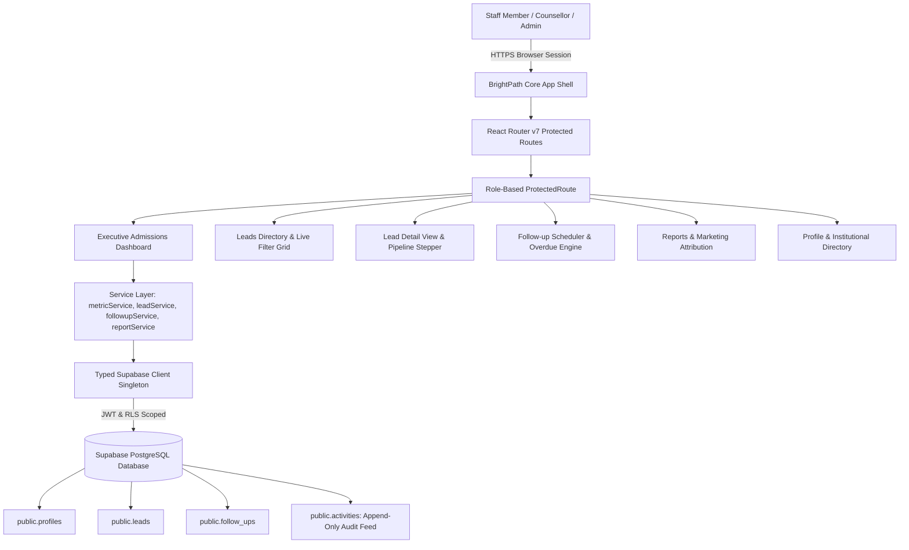

# BrightPath CRM — Education Admissions & Lead Management Platform

A modern, high-performance, real-time Customer Relationship Management (CRM) platform engineered specifically for coaching institutes, training academies, and higher education admissions teams.

Built with **React 19**, **TypeScript (Strict Mode)**, **Vite 8**, **Vanilla CSS Design Tokens**, and **Supabase (PostgreSQL with Row Level Security)**.

---

## 1. Architectural Overview & System Flow



---

## 2. Core Feature Highlights

### P0 Admissions Operations
- **Real-Time Executive Admissions Dashboard**:
  - Live reconciled KPI cards: Total Inquiries, New Inquiries, Admissions Converted, Conversion Rate %, Overdue Reminders.
  - Interactive pipeline stage funnel (`New` $\rightarrow$ `Contacted` $\rightarrow$ `Qualified` $\rightarrow$ `Converted` $\rightarrow$ `Lost`).
  - Lead acquisition channel attribution progress meters.
  - Urgent Action Queue with 1-click in-place completion and live activity logging.
  - Real-time institutional event stream.
- **Lead Capture & Field Validation**:
  - Prospective student modal with double-submission locks.
  - Phone formatting (at least 10 digits), required name, course selection, and marketing source.
  - Automatic audit activity generation (`LEAD_CREATED`).
- **Comprehensive Leads Directory**:
  - 300ms debounced multi-field search (Student Name, Phone, Email).
  - Status quick-tabs with live count badges.
  - Multi-criteria filtering by Course, Source, and Assigned Counsellor.
  - Responsive desktop grid + mobile card views.
- **Interactive Pipeline Progression & Detail View**:
  - 5-stage visual stepper with 1-click status advancement.
  - Mandatory cancellation modal with lost reason logging.
  - Chronological activity timeline with quick consultation note composer.
- **Follow-up Engine & Overdue Tracker**:
  - Native datetime-local scheduling with relative time formatting (*"Due Today"*, *"Overdue by 2 hrs"*).
  - Categorized tab queues: *All, Overdue, Due Today, Upcoming, Completed*.
  - 1-click completion workflow immediately resolving overdue state.

### P1 Analytics & Enterprise Governance
- **Reports & Conversion Analytics**:
  - Marketing channel conversion performance table with efficiency bars.
  - Academic course demand breakdown table.
  - Counsellor conversion efficiency table.
  - Segmented date window filters (*All Time, Last 30 Days, Last 7 Days, Today*).
- **Settings, User Profile & Team Directory**:
  - Profile display name self-service with real-time header and avatar synchronization.
  - Role immutability security callout explaining PostgreSQL RLS policies.
  - Complete institutional team directory with role badges and copy User ID action.
- **Strict Role-Based Access Control (RBAC)**:
  - Three distinct privilege tiers: `admin`, `manager`, and `counsellor`.
  - Database-level RLS policies preventing client-side privilege escalation.

---

## 3. Technology Stack

- **Frontend Core**: React 19, TypeScript 5+ (Strict Mode), Vite 8.
- **Routing**: `react-router-dom` v7.
- **Iconography**: `lucide-react`.
- **Styling Architecture**: Vanilla CSS with curated HSL tokens, dark slate glassmorphism (`backdrop-filter: blur(12px)`), responsive media queries, and GPU-accelerated micro-animations (`src/index.css`).
- **Database & Authentication**: Supabase PostgreSQL with Row Level Security (RLS) on all client tables.
- **Automated Verification**: End-to-end browser testing via `puppeteer-core` driving local Google Chrome.
- **CI/CD & Hosting**: Vercel automated deployments on `master` branch push.

---

## 4. Environment Variables Reference

Create a `.env` file in the project root:

```env
# Supabase Project URL
VITE_SUPABASE_URL=https://your-project.supabase.co

# Supabase Public / Anon Key (Safe for client bundle)
VITE_SUPABASE_ANON_KEY=sb_publishable_your_key_here
```

> **Security Rule**: Never expose `SUPABASE_SECRET_KEY` or service-role keys in frontend `.env` files. The frontend only requires the public publishable anon key.

---

## 5. Local Development Setup

### Prerequisites
- Node.js 18+ (tested on Node.js v20.x)
- npm 9+
- Google Chrome or Microsoft Edge

### Installation Steps
```bash
# 1. Clone repository
git clone https://github.com/PayF123/brightpath-crm.git
cd brightpath-crm

# 2. Install dependencies
npm install

# 3. Configure environment variables
cp .env.example .env
# Edit .env and supply your VITE_SUPABASE_URL and VITE_SUPABASE_ANON_KEY

# 4. Start development server
npm run dev
```

Visit **`http://localhost:5173/`** to access the application.

---

## 6. Supabase Database Bootstrap & Migration

All database tables, indexes, triggers, and Row Level Security policies are located in `supabase/migrations/`:

1. `20261018000001_initial_schema.sql`: Core schema for `profiles`, `leads`, `follow_ups`, and `activities`.
2. `20261018000002_rls_policies.sql`: Strict Row Level Security policies for role-based scoping.
3. `20261018000003_demo_seed.sql`: Initial course catalog and sample lead data.

### Elevating a User to Administrator (SQL Procedure)
Whenever a new staff member registers via the `/login` portal, they are automatically provisioned as a `counsellor`. To promote an account to `admin`, execute this in the **Supabase SQL Editor**:

```sql
UPDATE public.profiles
SET role = 'admin'
WHERE id = (
  SELECT id FROM auth.users WHERE email = 'your-admin-email@example.com'
);
```

---

## 7. Production Verification & Build Commands

```bash
# Type check without emitting files
npx tsc --noEmit

# Compile production bundle
npm run build

# Preview production build locally
npm run preview
```

---

## 8. License & Maintenance

Developed for **BrightPath Academy**. Built with zero fake data, full PostgreSQL audit reconciliation, and strict TypeScript compliance.
