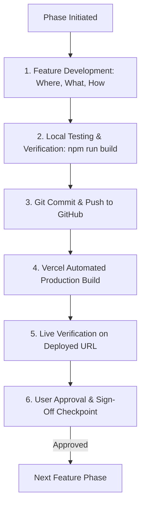

# BrightPath CRM — Master Feature-by-Feature Implementation Plan

This document serves as the project's living context, implementation guide, and verification tracking matrix based on the **BrightPath CRM Master Build Specification**.

---

## 1. Operating Rules & Feature-by-Feature Lifecycle

Every feature is developed, tested, verified, and deployed in an isolated phase following a strict 6-step lifecycle:

### Core Working Rules:
- **Zero Hallucination / Zero Fake Data**: Never disguise unconfigured states with hardcoded mock numbers. When keys are missing or database is empty, display truthful empty/unconfigured states.
- **Client Security Boundary**: Only `VITE_SUPABASE_URL` and `VITE_SUPABASE_ANON_KEY` are allowed in client bundles. Never include service-role keys or database passwords.
- **Verification First**: Never claim a test passed or a feature works without running the verification command or observing the live deployment.

---

## 2. Technology Stack & Architecture

- **Frontend**: React 19, TypeScript 5+ (Strict mode), Vite 8.
- **Routing**: `react-router-dom` v7.
- **Styling**: Vanilla CSS design system with CSS custom properties, responsive breakpoints, accessible focus states, and glassmorphic elevation (`src/index.css`).
- **Icons**: `lucide-react`.
- **Database & Auth**: Supabase PostgreSQL with strict Row Level Security (RLS) on all client-accessible tables.
- **Version Control & CI/CD**: Git + GitHub + Vercel automatic deployments on `main` branch push.

---

## 3. Order-Wise Phase & Feature Breakdown

---

### Phase 0: Baseline Repository, Tooling & Build Pipeline
- **Status**: **COMPLETED & COMMITTED** (`28e0217`)
- **Where**:
  - `package.json`, `tsconfig.json`, `vite.config.js`, `.gitignore`, `.env.example`
  - `src/main.tsx`, `src/App.tsx`, `src/vite-env.d.ts`, `index.html`
- **What Was Implemented**:
  - Initialized Git repository and set `.gitignore` to prevent secret leakage (`.env`, `node_modules`, `dist`).
  - Installed `@supabase/supabase-js`, `react-router-dom`, `lucide-react`, `typescript`, `@types/react`, `@types/react-dom`.
  - Configured strict TypeScript (`tsconfig.json`) and created template `.env.example`.
  - Converted entry files to TypeScript (`.tsx`) and confirmed `npm run build` succeeds cleanly.
- **Acceptance Checklist**:
  - [x] TypeScript compilation passes (`npx tsc --noEmit` exits 0).
  - [x] Production build passes (`npm run build` exits 0).
  - [x] Working tree clean; committed to local Git.

---

### Phase 1: Design System, Core App Shell & Responsive Navigation
- **Objective**: Build the visual identity, global layout, navigation components, and route shells for the CRM.
- **Where**:
  - Global styles: `src/index.css`
  - Layout components: `src/components/layout/AppLayout.tsx`, `Sidebar.tsx`, `Header.tsx`, `MobileNav.tsx`
  - Routing configuration: `src/App.tsx`
  - View shells: `src/features/dashboard/DashboardShell.tsx`, `src/features/leads/LeadsShell.tsx`, `src/features/followups/FollowupsShell.tsx`, `src/features/reports/ReportsShell.tsx`, `src/features/settings/SettingsShell.tsx`, `src/features/auth/LoginShell.tsx`
- **What**:
  - **Color Palette & Design Tokens**: Navy primary (`#0f172a`), dark slate card backgrounds (`#1e293b`), vibrant brand blue (`#2563eb`), emerald success (`#10b981`), amber warning (`#f59e0b`), rose danger (`#f43f5e`), neutral light text (`#f8fafc`).
  - **Desktop Sidebar**: Fixed 260px sidebar with brand logo, institute label, navigation links (Dashboard, Leads, Follow-ups, Reports, Settings), active route pill highlight, and collapse toggle.
  - **Mobile Navigation Drawer**: Responsive slide-over drawer triggered by header hamburger button for screens `< 768px`.
  - **Header Bar**: Top bar displaying current page title, breadcrumb trail, and user profile avatar placeholder.
  - **Route Setup**: `react-router-dom` mapping `/`, `/leads`, `/leads/:id`, `/followups`, `/reports`, `/settings`, `/login`.
- **How**:
  - CSS variables in `:root` for seamless theme maintenance.
  - Standard CSS Flexbox & CSS Grid without heavy third-party UI framework bloat.
  - ARIA attributes (`aria-current="page"`, `aria-expanded`, `aria-label`) on all interactive buttons and links.
- **Lifecycle Steps**:
  1. **Develop**: Write `index.css`, layout components, and route shells.
  2. **Local Test**: Verify responsive behavior on desktop (1440px) and mobile (375px). Run `npm run build`.
  3. **Deploy**: Push commit to GitHub -> Vercel auto-deploys.
  4. **Live Test**: Open live Vercel URL on mobile and desktop browsers; test drawer toggling and link navigation.
  5. **Approval**: Pause for user review before Phase 2.

---

### Phase 2: Supabase Client & Environment Sentinel Banner
- **Objective**: Establish the Supabase client connection layer with automatic detection of missing environment variables and a truthful configuration banner.
- **Where**:
  - `src/lib/supabaseClient.ts`
  - `src/components/common/EnvConfigBanner.tsx`
  - Integration inside `src/components/layout/AppLayout.tsx`
- **What**:
  - **Supabase Client Singleton**: Exports typed `supabase` client initialized from `import.meta.env.VITE_SUPABASE_URL` and `import.meta.env.VITE_SUPABASE_ANON_KEY`.
  - **Environment Sentinel**: Helper function `isSupabaseConfigured(): boolean` verifying values are non-empty and not default placeholders.
  - **Config Banner Component**: Renders a clean, dismissed-capable alert at the top of the app explaining that Supabase is not yet connected, guiding the user to configure `.env` locally or Vercel environment variables in production.
- **How**:
  - Prevents the app from crashing on initial load if environment variables are not yet injected.
  - Adheres to the specification rule: *Never silently fake data or disguise unconfigured states*.
- **Lifecycle Steps**:
  1. **Develop**: Implement `supabaseClient.ts` and `EnvConfigBanner.tsx`.
  2. **Local Test**: Verify app renders with the banner when `.env` is absent; verify banner hides when valid dummy credentials are provided. Run `npm run build`.
  3. **Deploy**: Push commit to GitHub -> Vercel auto-deploys.
  4. **Live Test**: Check live deployment URL displays the setup banner clearly before project variables are added.
  5. **Approval**: Pause for user review before Phase 3.

---

### Phase 3: Database Foundation, Migrations & RLS Policies
- **Objective**: Author reproducible, idempotent SQL migrations for all tables, indexes, triggers, and Row Level Security policies.
- **Where**:
  - `supabase/migrations/20261018000001_initial_schema.sql`
  - `supabase/migrations/20261018000002_rls_policies.sql`
  - `supabase/migrations/20261018000003_demo_seed.sql`
  - `src/types/database.types.ts`
  - `supabase/README.md`
- **What**:
  - **Table 1: `profiles`**:
    - `id UUID PRIMARY KEY REFERENCES auth.users(id) ON DELETE CASCADE`
    - `full_name TEXT NOT NULL`
    - `role TEXT NOT NULL DEFAULT 'counsellor' CHECK (role IN ('admin', 'manager', 'counsellor'))`
    - `created_at TIMESTAMPTZ NOT NULL DEFAULT NOW()`
    - `updated_at TIMESTAMPTZ NOT NULL DEFAULT NOW()`
  - **Table 2: `leads`**:
    - `id UUID PRIMARY KEY DEFAULT gen_random_uuid()`
    - `full_name TEXT NOT NULL`
    - `email TEXT`
    - `phone TEXT NOT NULL`
    - `course_interest TEXT NOT NULL`
    - `source TEXT NOT NULL CHECK (source IN ('Website', 'Walk-in', 'Referral', 'Social Media', 'Phone Inquiry', 'Other'))`
    - `status TEXT NOT NULL DEFAULT 'New' CHECK (status IN ('New', 'Contacted', 'Qualified', 'Converted', 'Lost'))`
    - `assigned_to UUID REFERENCES profiles(id) ON DELETE SET NULL`
    - `created_by UUID REFERENCES profiles(id) ON DELETE SET NULL`
    - `notes TEXT`
    - `created_at TIMESTAMPTZ NOT NULL DEFAULT NOW()`
    - `updated_at TIMESTAMPTZ NOT NULL DEFAULT NOW()`
  - **Table 3: `follow_ups`**:
    - `id UUID PRIMARY KEY DEFAULT gen_random_uuid()`
    - `lead_id UUID NOT NULL REFERENCES leads(id) ON DELETE CASCADE`
    - `assigned_to UUID REFERENCES profiles(id) ON DELETE SET NULL`
    - `due_at TIMESTAMPTZ NOT NULL`
    - `note TEXT NOT NULL`
    - `status TEXT NOT NULL DEFAULT 'pending' CHECK (status IN ('pending', 'completed', 'cancelled'))`
    - `completed_at TIMESTAMPTZ`
    - `created_by UUID REFERENCES profiles(id) ON DELETE SET NULL`
    - `created_at TIMESTAMPTZ NOT NULL DEFAULT NOW()`
  - **Table 4: `activities`**:
    - `id UUID PRIMARY KEY DEFAULT gen_random_uuid()`
    - `lead_id UUID NOT NULL REFERENCES leads(id) ON DELETE CASCADE`
    - `actor_id UUID REFERENCES profiles(id) ON DELETE SET NULL`
    - `activity_type TEXT NOT NULL`
    - `description TEXT NOT NULL`
    - `metadata JSONB DEFAULT '{}'::jsonb`
    - `created_at TIMESTAMPTZ NOT NULL DEFAULT NOW()`
  - **Automated Trigger**: `on_auth_user_created` trigger automatically inserts a new row into `profiles` with role `'counsellor'` whenever a user signs up.
  - **Row Level Security**:
    - Enable RLS on all 4 tables.
    - Profiles: Users can read all team profiles (to allow lead assignment) and update only their own `full_name`. Role column cannot be modified by non-admin users.
    - Leads: Counsellors can SELECT, INSERT, UPDATE only leads where `assigned_to = auth.uid()` or `created_by = auth.uid()`. Managers & Admins can access all leads.
    - Follow-ups & Activities: Access governed by access to the parent lead.
- **How**:
  - The migration files are written to the repository so they can be executed in the Supabase SQL Editor or via Supabase CLI.
  - Provide a clear, step-by-step SQL bootstrap guide in `supabase/README.md`.
- **Lifecycle Steps**:
  1. **Develop**: Generate migration files and `database.types.ts`.
  2. **Local Test**: Verify SQL syntax and TypeScript definitions alignment. Run `npm run build`.
  3. **Human Action**: User executes migration scripts in the Supabase Dashboard SQL Editor.
  4. **Deploy**: Push migration files to GitHub repository.
  5. **Verification**: Inspect Supabase Table Editor; confirm 4 tables created with active RLS policies.
  6. **Approval**: Pause for user review before Phase 4.

---

### Phase 4: Authentication Engine & Role Lifecycle (RBAC)
- **Objective**: Implement secure sign-in, sign-out, session restoration, user profile hydration, and role-based route guards.
- **Where**:
  - Context & Hooks: `src/context/AuthContext.tsx`, `src/hooks/useAuth.ts`
  - Service: `src/services/authService.ts`
  - UI Views: `src/features/auth/LoginPage.tsx`, `src/components/common/ProtectedRoute.tsx`
  - Header Profile Menu: `src/components/layout/Header.tsx`
- **What**:
  - **Sign-In Form**: Email and password inputs with client validation, loading state, error display (invalid credentials, rate limiting, connection failure).
  - **Session Management**: Listens to Supabase `onAuthStateChange`. Restores active session on page refresh.
  - **Profile & Role Hydration**: Fetches corresponding record from `profiles` table to determine user role (`admin`, `manager`, `counsellor`).
  - **Role-Based Guards**: Prevents unauthenticated access to protected pages; restricts manager/admin views.
  - **Sign-Out Action**: Securely clears session tokens and resets UI state.
  - **Admin Bootstrap Documentation**: SQL query provided for the project owner to safely elevate a test user to `admin`.
- **How**:
  - React Context API handles centralized auth state without extra heavy libraries.
  - Client state mirrors Supabase Auth session tokens stored securely in browser `localStorage`.
- **Lifecycle Steps**:
  1. **Develop**: Build `AuthContext`, `authService`, `LoginPage`, and `ProtectedRoute`.
  2. **Local Test**: Test sign-in with valid and invalid credentials. Verify session persistence after browser refresh. Run `npm run build`.
  3. **Deploy**: Push to GitHub -> Vercel auto-deploys.
  4. **Live Test**: Sign in on the live Vercel URL; verify redirect to Dashboard, test Sign Out, and verify `/login` redirect when visiting protected routes.
  5. **Approval**: Pause for user review before Phase 5.

---

### Phase 5: Lead Management — Creation & Field Validation (P0)
- **Objective**: Implement the lead capture workflow allowing counsellors/managers to add prospective students with input validation and automated activity logging.
- **Where**:
  - Modal Component: `src/features/leads/LeadFormModal.tsx`
  - Service: `src/services/leadService.ts`, `src/services/activityService.ts`
  - Integration: `src/features/leads/LeadsListPage.tsx`
- **What**:
  - **"New Lead" Modal Button**: Prominent "+ Add Lead" action in navigation and lead views.
  - **Form Fields**:
    - Student Full Name (Required, trimmed, min 2 chars).
    - Phone Number (Required, formatted/validated).
    - Email Address (Optional, validated with regex if provided).
    - Course Interest (Required dropdown).
    - Lead Source (Required dropdown: Website, Walk-in, Referral, Social Media, Phone Inquiry).
    - Initial Counsellor Notes (Optional textarea).
    - Assignee (Dropdown populated from `profiles`; defaults to current user for counsellors; selectable for managers).
  - **Double-Submission Prevention**: Submit button enters loading state and is disabled during Supabase insertion.
  - **Automatic Audit Logging**: On successful lead creation, automatically inserts an activity row (`activity_type: 'LEAD_CREATED'`).
  - **Feedback**: Toast or inline notification on success; inline error messages for invalid fields.
- **How**:
  - Uses typed `leadService.createLead()` invoking `supabase.from('leads').insert()`.
  - Transaction-like activity logging guarantees lead creation is audited immediately.
- **Lifecycle Steps**:
  1. **Develop**: Implement `LeadFormModal`, validation logic, and services.
  2. **Local Test**: Test submitting empty form, invalid phone, invalid email. Submit valid lead and verify record in Supabase. Run `npm run build`.
  3. **Deploy**: Push to GitHub -> Vercel auto-deploys.
  4. **Live Test**: Open live Vercel URL, create a new lead, refresh page, check Supabase Table Editor to verify row exists with correct `created_by` foreign key.
  5. **Approval**: Pause for user review before Phase 6.

---

### Phase 6: Lead Management — Directory, Search & Multi-Filters (P0)
- **Objective**: Build a responsive directory displaying student leads with real-time text search, multi-field filtering, sorting, and empty states.
- **Where**:
  - Page: `src/features/leads/LeadsListPage.tsx`
  - Components: `src/features/leads/LeadTable.tsx`, `LeadCardsMobile.tsx`, `LeadFilters.tsx`
  - Common: `src/components/common/LoadingSkeleton.tsx`, `src/components/common/EmptyState.tsx`, `src/components/common/StatusBadge.tsx`
- **What**:
  - **Desktop Data Grid**: Columns for Student Name, Contact Info (Phone/Email), Course, Source, Status Badge, Assigned Counsellor, Created Date, and Quick Actions.
  - **Mobile Card View**: Responsive card layout displaying essential contact details and status badges on small screens without table overflow.
  - **Real-Time Text Search**: Searches across Student Name, Phone Number, and Email.
  - **Multi-Criteria Filter Bar**:
    - Filter by Status (`All`, `New`, `Contacted`, `Qualified`, `Converted`, `Lost`).
    - Filter by Lead Source (`All`, `Website`, `Walk-in`, etc.).
    - Filter by Assignee (for Managers/Admins).
  - **Filter Reset**: "Clear Filters" button to reset view to defaults.
  - **Loading & Empty States**: Skeleton rows while fetching; clear graphic message when no records match filter criteria.
- **How**:
  - Server-assisted filtering through Supabase query chaining (`.ilike()`, `.eq()`, `.order()`).
  - Debounced search input (300ms) to prevent excessive network requests.
- **Lifecycle Steps**:
  1. **Develop**: Build `LeadsListPage`, `LeadTable`, `LeadCardsMobile`, and `LeadFilters`.
  2. **Local Test**: Filter by each status; search by partial phone number; test mobile responsive cards. Run `npm run build`.
  3. **Deploy**: Push to GitHub -> Vercel auto-deploys.
  4. **Live Test**: Filter and search leads on live deployed site on both desktop and mobile viewports.
  5. **Approval**: Pause for user review before Phase 7.

---

### Phase 7: Lead Details, Editing & Status Pipeline Progression (P0)
- **Objective**: Implement the comprehensive lead detail view with status pipeline progression, mandatory lost reasons, and chronological activity timeline.
- **Where**:
  - Page: `src/features/leads/LeadDetailPage.tsx`
  - Components: `src/features/leads/LeadStatusStepper.tsx`, `LeadActivityTimeline.tsx`, `LostReasonModal.tsx`
  - Service: `src/services/leadService.ts`, `src/services/activityService.ts`
- **What**:
  - **Header & Info Card**: Student contact information, course interest, source, and counsellor notes with an "Edit Details" modal.
  - **Visual Status Pipeline Stepper**:
    - Interactive progression: `New` → `Contacted` → `Qualified` → `Converted` or `Lost`.
    - One-click status updates with immediate database persistence.
  - **Mandatory Lost Reason**: If user selects `Lost`, opens a modal requiring a cancellation/lost reason.
  - **Activity Timeline**: Displays full audit history for the lead:
    - Lead created (with timestamp and actor).
    - Status changed from X to Y (with actor).
    - Follow-up completed or scheduled.
    - Counsellor notes updated.
- **How**:
  - Updates `leads.status` and appends a record in `activities` table with `activity_type = 'STATUS_CHANGED'` and metadata `{ previous_status: X, new_status: Y, reason: Z }`.
- **Lifecycle Steps**:
  1. **Develop**: Build `LeadDetailPage`, `LeadStatusStepper`, `LeadActivityTimeline`, and `LostReasonModal`.
  2. **Local Test**: Advance lead status through pipeline; test marking as `Lost` with reason; verify timeline entries update immediately. Run `npm run build`.
  3. **Deploy**: Push to GitHub -> Vercel auto-deploys.
  4. **Live Test**: Open a lead on live site, change status, refresh page, verify persistence and timeline log integrity.
  5. **Approval**: Pause for user review before Phase 8.

---

### Phase 8: Follow-up Scheduling & Overdue Notification Engine (P0)
- **Objective**: Deliver follow-up task management with due date/time tracking, overdue status calculation, and completion workflows.
- **Where**:
  - Page: `src/features/followups/FollowUpsPage.tsx`
  - Modal: `src/features/followups/FollowUpModal.tsx`
  - Components: `src/features/followups/FollowUpList.tsx`, `src/features/followups/FollowUpCard.tsx`
  - Services & Utils: `src/services/followupService.ts`, `src/utils/dateUtils.ts`
- **What**:
  - **"Schedule Follow-up" Modal**:
    - Target Lead (pre-selected if opened from lead detail, or searchable dropdown).
    - Due Date & Time picker (native accessible datetime-local input).
    - Action Note.
    - Assignee.
  - **Overdue Engine Logic**:
    - An item is **Overdue** if and only if: `status = 'pending' AND due_at < NOW()`.
    - Prominently flagged with a danger red badge and formatted relative time.
  - **Follow-up State Machine**:
    - `pending`: Active task waiting for action.
    - `completed`: Marked complete with single click. Records `completed_at = NOW()`. **Immediately ceases being overdue**.
    - `cancelled`: Cancelled with confirmation.
  - **Activity Logging**: Completing a follow-up logs an entry in `activities` table.
  - **Direct Lead Navigation**: Clicking any follow-up navigates directly to `/leads/:id`.
- **How**:
  - Date comparisons use standard UTC ISO strings in PostgreSQL with browser local timezone rendering.
- **Lifecycle Steps**:
  1. **Develop**: Implement follow-up scheduler, overdue calculations, and completion service.
  2. **Local Test**: Create a follow-up in the past -> verify it displays as Overdue. Mark completed -> verify badge changes to Completed and timestamp is recorded. Run `npm run build`.
  3. **Deploy**: Push to GitHub -> Vercel auto-deploys.
  4. **Live Test**: Schedule and complete follow-ups on the live deployment; test direct link navigation to parent lead.
  5. **Approval**: Pause for user review before Phase 9.

---

### Phase 9: Real-Time Dashboard & Truthful Metrics Reconciliation (P0)
- **Objective**: Build the live executive dashboard with KPI cards and distribution widgets reconciled with live database queries (zero hardcoded fake charts).
- **Where**:
  - Page: `src/features/dashboard/DashboardPage.tsx`
  - Components: `src/features/dashboard/KpiCard.tsx`, `src/features/dashboard/StatusDistributionChart.tsx`, `src/features/dashboard/SourceDistributionWidget.tsx`, `src/features/dashboard/UpcomingFollowupsWidget.tsx`
  - Service: `src/services/metricService.ts`
- **What**:
  - **KPI Summary Cards**:
    - **Total Leads**: Count of all accessible leads.
    - **New Leads**: Count of leads with `status = 'New'`.
    - **Converted Leads**: Count of leads with `status = 'Converted'`.
    - **Overdue Follow-ups**: Count of pending follow-ups with `due_at < NOW()`.
    - **Conversion Rate**: `(Converted / Total) * 100` (safe against zero division).
  - **Pipeline Distribution**: Visual progress breakdown showing percentage of leads in each stage.
  - **Acquisition Source Widget**: Distribution breakdown by enquiry source.
  - **Upcoming & Overdue Follow-ups Widget**: Displays top urgent follow-ups with one-click completion buttons.
  - **Role Scoping**: Counsellor view reflects only their assigned leads; Manager/Admin view aggregates institute-wide numbers.
- **How**:
  - `metricService.getDashboardMetrics()` performs truthful aggregated queries against Supabase tables.
  - Numbers strictly reconcile with the record counts in the Leads and Follow-ups tables.
- **Lifecycle Steps**:
  1. **Develop**: Build `DashboardPage`, `KpiCard`, distribution widgets, and `metricService`.
  2. **Local Test**: Compare KPI cards with database records; convert a lead and verify live metrics increment. Test with zero records. Run `npm run build`.
  3. **Deploy**: Push to GitHub -> Vercel auto-deploys.
  4. **Live Test**: Verify dashboard KPIs against Supabase Table Editor on live Vercel URL.
  5. **Approval**: Pause for user review before Phase 10.

---

### Phase 10: Reports & Conversion Analytics (P1)
- **Objective**: Provide detailed breakdown tables showing conversion rates by acquisition channel, course interest, and counsellor performance.
- **Where**:
  - Page: `src/features/reports/ReportsPage.tsx`
  - Components: `src/features/reports/SourcePerformanceTable.tsx`, `CourseInterestTable.tsx`, `DateRangeFilter.tsx`
- **What**:
  - **Source Performance Analysis**: Table showing Source, Total Inquiries, Converted Count, and Conversion % per channel.
  - **Course Demand Summary**: Inquiries received per course offering.
  - **Date Range Presets**: Filter metrics by `Last 7 Days`, `Last 30 Days`, or `All Time`.
  - **Empty Dataset Handling**: Informative empty states when no leads exist for a selected date window.
- **How**:
  - Computes aggregates using the identical metric formulas defined in the dashboard to maintain consistency.
- **Lifecycle Steps**:
  1. **Develop**: Implement `ReportsPage` and performance summary tables.
  2. **Local Test**: Filter date ranges and verify channel conversion numbers match individual lead records. Run `npm run build`.
  3. **Deploy**: Push to GitHub -> Vercel auto-deploys.
  4. **Live Test**: Check reports on live Vercel deployment with different sample leads.
  5. **Approval**: Pause for user review before Phase 11.

---

### Phase 11: Settings, User Profile & Team Directory
- **Objective**: Allow users to inspect their profile, update display name, view assigned role (read-only), and view team members (manager/admin).
- **Where**:
  - Page: `src/features/settings/SettingsPage.tsx`
  - Components: `src/features/settings/ProfileCard.tsx`, `src/features/settings/TeamMembersList.tsx`
- **What**:
  - **Profile Information**: User ID, email, role badge (`Admin`, `Manager`, `Counsellor`), and account created date.
  - **Update Name**: Input field allowing users to edit their `full_name` in `profiles`.
  - **Role Immutability Notice**: Explanatory security callout stating role privileges can only be modified by the organization administrator via Supabase SQL.
  - **Team Directory (Manager/Admin View)**: List active counsellors, their assigned roles, and contact info for lead delegation.
- **How**:
  - Updates `profiles.full_name` via `supabase.from('profiles').update()`. RLS prevents updating the `role` column.
- **Lifecycle Steps**:
  1. **Develop**: Build `SettingsPage` and `ProfileCard`.
  2. **Local Test**: Update user full name; verify updated name appears in navigation header. Verify role column cannot be updated. Run `npm run build`.
  3. **Deploy**: Push to GitHub -> Vercel auto-deploys.
  4. **Live Test**: Test profile update and team directory on live Vercel deployment.
  5. **Approval**: Pause for user review before Phase 12.

---

### Phase 12: Security Hardening, Multi-Role Audit & Handover
- **Objective**: Conduct comprehensive security audit, verify RLS with multi-role test users, perform clean production build, and deliver full handover documentation.
- **Where**:
  - Documentation: `README.md`, `supabase/README.md`
  - Root project verification
- **What**:
  - **Multi-Role RLS Audit**:
    - Test User A (Counsellor): Confirm cannot view leads assigned to User B.
    - Test User B (Manager/Admin): Confirm can view and reassign all leads.
  - **Final Code Hygiene**: Run `npm run build` and `npm run lint` to guarantee clean exit code 0.
  - **Handover Documentation (`README.md`)**:
    - Architectural diagram and component overview.
    - Step-by-step local setup instructions.
    - Supabase database migration and admin bootstrap SQL procedures.
    - Vercel production deployment and environment variable guide.
    - Production considerations, quota awareness, and out-of-scope roadmap.
- **Lifecycle Steps**:
  1. **Execute Checks**: Run full automated lint and type check.
  2. **Document**: Write comprehensive `README.md`.
  3. **Deploy**: Final commit and push to GitHub.
  4. **Live Verification**: Complete full end-to-end user journey test on the live production URL.
  5. **Sign-off**: Final handover.

---

## 4. Phase Tracking Matrix

| Phase | Description | Scope | Status |
| :--- | :--- | :--- | :--- |
| **Phase 0** | Baseline Tooling, TypeScript, Build Pipeline | Setup | **COMPLETED & COMMITTED** |
| **Phase 1** | Design System, App Shell, Responsive Navigation | UI / Layout | **COMPLETED & VERIFIED LOCALLY** |
| **Phase 2** | Supabase Client & Config Sentinel Banner | Integration | **Ready to Implement** |
| **Phase 3** | Database Migrations, Schema & RLS Policies | Database | Pending Phase 2 |
| **Phase 4** | Authentication & Role Lifecycle (RBAC) | Auth | Pending Phase 3 |
| **Phase 5** | Lead Creation & Validation (P0) | Core Feature | Pending Phase 4 |
| **Phase 6** | Lead Directory, Search & Multi-Filters (P0) | Core Feature | Pending Phase 5 |
| **Phase 7** | Lead Detail, Pipeline & Activity Log (P0) | Core Feature | Pending Phase 6 |
| **Phase 8** | Follow-up Engine & Overdue Tracker (P0) | Core Feature | Pending Phase 7 |
| **Phase 9** | Real-Time Dashboard & Metric Reconciliation (P0) | Core Feature | Pending Phase 8 |
| **Phase 10** | Reports & Conversion Analytics (P1) | Analytics | Pending Phase 9 |
| **Phase 11** | Settings, User Profile & Team Management | Admin | Pending Phase 10 |
| **Phase 12** | Multi-Role Security Audit & Student Handover | Verification | Final Phase |
